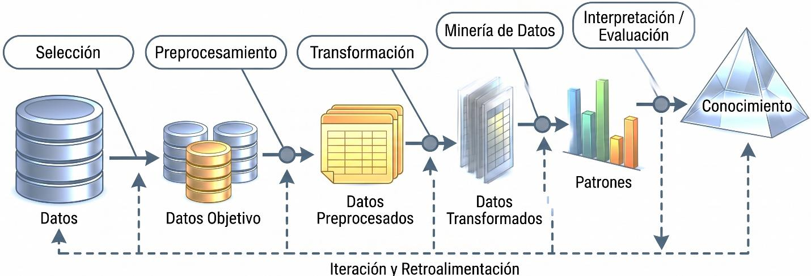

# Metodología

## 1. Enfoque KDD

El proyecto sigue las cinco fases del proceso de descubrimiento de conocimiento en bases de datos:

1. **Selección:** datos de precios mayoristas de SISAP–MIDAGRI.
2. **Preprocesamiento:** auditoría de nulos, duplicados, unidades y atípicos.
3. **Transformación:** normalización a S/ kg, log-precio, cambios, rezagos y variables de calendario.
4. **Minería:** comparación de modelos supervisados.
5. **Evaluación:** R², MAE, mejora frente a una referencia y acierto direccional.

Cada fase deja un artefacto verificable y la siguiente consume ese artefacto. El pipeline se detiene
si una fase deja de ser coherente con la anterior.

## 2. Datos

| Elemento | Valor |
|---|---|
| Fuente | SISAP, módulo Precios de ciudades |
| Unidad | departamento × producto × mes |
| Departamento | 24 unidades oficiales |
| Categorías | 9 productos armonizados |
| Crudo | 102 808 filas |
| Panel | 43 921 filas |
| Limpio | 43 855 filas |
| Atípicos | 66 |
| Ventana densa | 2012–2023 |

El catálogo `data/reference/departamentos.csv` es la fuente única de nombres, códigos y coordenadas.
Se excluyen Callao, Andahuaylas, Chota y Jaén porque no son departamentos.

La cobertura no es un panel balanceado: 81 de 216 series terminan antes de noviembre de 2026 y 17
empiezan después de 2012. Por eso cada modelo declara su muestra efectiva.

## 3. Limpieza

El SISAP publica precios en kilogramos, arrobas, sacos, cajas y otras presentaciones. Para cada
departamento y producto se elige la unidad dominante y se divide el valor por su equivalencia en
kilogramos.

Se marcan como atípicos los valores con:

- cociente mayor que 4 o menor que 0,25 frente a la mediana móvil local;
- cociente mayor que 5 o menor que 0,2 frente a la mediana nacional del mismo producto y mes;
- precio menor que 0,05 S/ kg.

Los valores no se imputan: se excluyen y se reportan. Se descartaron 66 observaciones.

## 4. EDA

El análisis exploratorio revisa:

- cobertura por año, departamento y producto;
- distribución de precios y efecto del logaritmo;
- correlación de cambios mensuales entre departamentos;
- relación de cada departamento con Lima;
- distancia geográfica y zona natural.

La relación con Lima es heterogénea. Para papa, Ica y Huánuco se mueven relativamente cerca de Lima;
Tumbes y Loreto casi no comparten movimiento. La distancia es significativa (p = 0,022), mientras
que la zona natural por sí sola no lo es (p = 0,196).

## 5. Variables y ventanas temporales

Para cada producto se construye una tabla mensual con:

- `y`: cambio logarítmico de Puno;
- `dl0`: cambio de Lima del mismo mes;
- `dl1`–`dl3`: cambios de Lima rezagados;
- `dp1`–`dp2`: cambios propios rezagados;
- `sin1`, `cos1`: estacionalidad anual.

La matriz se construye antes de recortar la ventana, para que un mes faltante no se trate como si
fuera el mes anterior.

| Ventana | Uso |
|---|---|
| 1997–2026 | Fuente completa |
| 2012–2023 | EDA y ventana densa |
| 2012–2017 | Entrenamiento |
| 2018–2020 | Validación |
| 2021–octubre 2026 | Prueba final |
| Noviembre 2026 | Fuera de la prueba |

El `N` no es el número de meses calendario: es el número de meses con datos completos después de
construir cambios y rezagos. La tabla completa está en
`outputs/analisis/06_modelos/n_etapas.csv`.

## 6. Modelos

Se comparan seis modelos:

| Modelo | Familia | Configuración |
|---|---|---|
| OLS | lineal | sin hiperparámetros |
| Ridge | lineal regularizado | alpha = 1, estandarización |
| Árbol de Decisión | no lineal, árbol único | profundidad 5, hoja mínima 5 |
| Random Forest | no lineal, bagging | 300 árboles, hoja mínima 3 |
| XGBoost | no lineal, boosting | 300 árboles, learning rate 0,05, profundidad 4 |
| LightGBM | no lineal, boosting | 300 árboles, learning rate 0,05, 7 hojas |

La estimación del mes corriente usa el cambio de Lima del mismo mes, sus rezagos, los rezagos
propios y los armónicos. El pronóstico a un mes usa niveles y la mediana de los otros 22
departamentos.

La selección se hace por rango promedio de R² en validación. La prueba final se usa una sola vez.
No se elige el modelo mirando la prueba final.

## 7. Evaluación

- **R²:** proporción de variación explicada.
- **MAE:** error absoluto medio.
- **Mejora del MAE:** `100 × (1 − MAE_modelo / MAE_referencia)`.
- **Acierto direccional:** porcentaje de signos correctos entre meses con cambio distinto de cero.
- **Matriz de confusión direccional:** conteo de aciertos y errores de signo de la predicción de
  regresión. No es un clasificador entrenado; solo lee el signo de una predicción continua.

La referencia de la estimación contemporánea es predecir cambio cero. La referencia del pronóstico
es la caminata aleatoria.

## 8. Reproducibilidad y límites

- Semillas fijas en los modelos.
- Catálogo único de 24 departamentos.
- Manifiestos y validadores por fase.
- Separación temporal estricta entre entrenamiento, validación y prueba final.

Límites:

- datos mensuales;
- panel no balanceado;
- no hay volúmenes, costos de transporte ni precios minoristas;
- no se verificó el rezago de publicación;
- los resultados son predictivos y asociativos, no causales.
